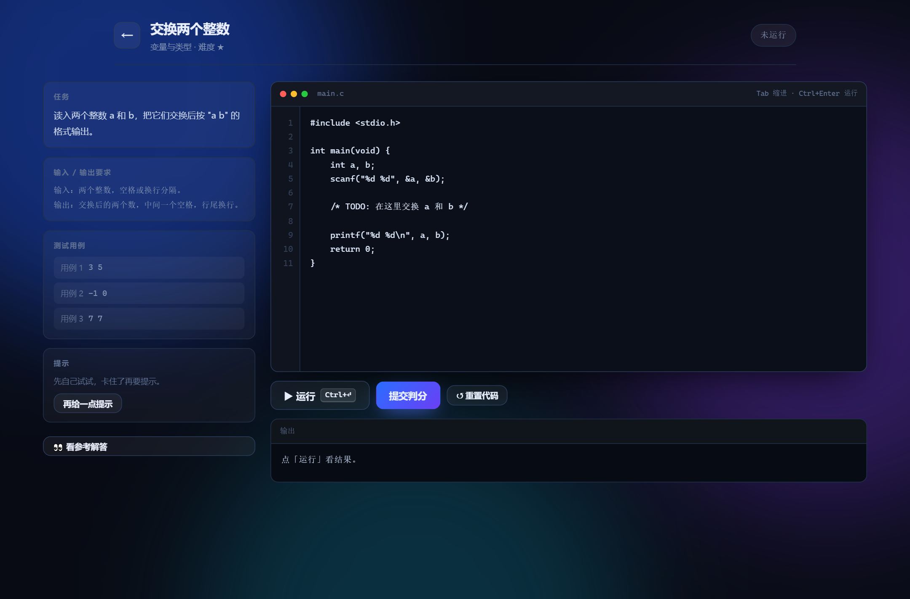
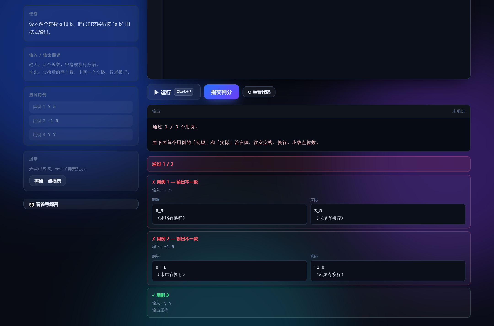
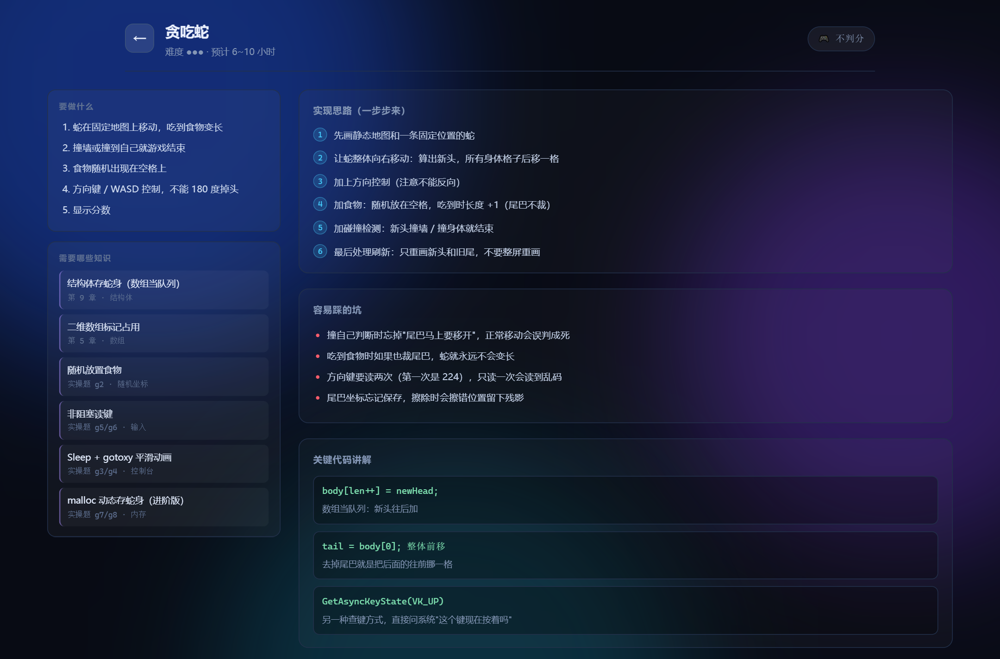

# C 语言闯关 · C Quest

一个用**真实 C 代码**做题的闯关学习游戏。**70 道读代码题 + 40 道动手写代码的实操题 + 5 个游戏开发大作业**。

> **在线体验**: https://ephemeral-semifreddo-456043.netlify.app
>
> 打开就能玩，不用安装任何东西。实操题里的 C 代码是真的在**你的浏览器里编译运行**的。


---

## 这是什么

给学 C 语言的人做的练习工具。和普通刷题网站的区别：

- **每道题的答案都是编译器跑出来的**，不是手写的。49 道"预测输出"题全部真编译真运行验证过。
- **实操题能真编译真判分**。你在网页里写 C 代码，Clang 22（WebAssembly 版）在浏览器里编译运行，
  逐个测试用例比对输出。少写一个换行符都会判错。
- **算法题有对拍验证**。每道算法题额外写了一个暴力解法，用随机数据跑 400 次比对，确保参考解答在边界上也没错。
- **游戏开发大作业**。5 个经典小游戏（贪吃蛇/俄罗斯方块/2048/扫雷/推箱子），
  每个都给需求清单、知识点（标注来自前面哪一课）、分步思路、易错点和完整可运行的成品代码。不判分。

## 快速开始

### 方式一：直接玩在线版

打开 https://ephemeral-semifreddo-456043.netlify.app 即可。

### 方式二：本地跑

```bash
# 1. 安装依赖（只为把编译器资源复制出来）
npm install
npm run setup

# 2. 启动
npm run serve
# 然后打开 http://127.0.0.1:7788
```

Windows 用户也可以直接双击 `开始游戏.bat` 选 1。

> 注意：不能直接双击 `index.html`。浏览器出于安全限制，
> `file://` 页面读不到 WebAssembly 资源，实操题会提示需要起服务。

### 方式三：终端版

```bash
tools/tcc/tcc.exe -o c-quest.exe c-quest.c
./c-quest.exe
```

纯终端里的 C 程序，70 道读代码题 + 40 道实操题（用本地 TCC 编译）。

---

## 怎么玩

**双击 `开始游戏.bat`，选 1。**

它会起一个本地小服务并自动打开浏览器。这个服务只做一件事：让你能加载
**跑在浏览器里的 C 编译器**（Clang 22 编译成 WebAssembly，约 28MB，首次加载约 1 秒）。

> 为什么需要它：浏览器默认不允许 `file://` 页面读取本地 wasm 资源。
> 起个 `http://127.0.0.1:7788` 就能绕开这个限制，而且不需要任何后端来编译代码——
> 编译完全在你的浏览器里完成，代码不会离开这台电脑。

### 三种打开方式

| 方式 | 读代码题 | 实操题（写代码判分） | 游戏大作业 |
|---|---|---|---|
| `开始游戏.bat` 选 1（**推荐**） | ✅ | ✅ 真编译真判分 | ✅ 看代码 |
| 直接双击 `index.html` | ✅ | ⚠️ 能看能写，但跑不了 | ✅ 看代码 |
| 终端版（bat 选 2） | ✅ | ✅ 用本地 TCC 编译 | ❌ |

**没装 Node.js 也能用**：双击 `index.html` 就能玩 70 道读代码题和 5 个游戏大作业，
只是实操题的「运行」和「提交判分」用不了。

### 浏览器内编译器的实测数据

| 项目 | 耗时 |
|---|---|
| 首次加载（28MB，冷缓存） | ~900ms |
| 首次编译+运行 | ~900ms |
| 之后每次编译 | ~370-670ms |
| 一次完整提交（3 个用例） | ~370ms |
| 死循环保护 | 8 秒强制终止 |

死循环是真会挂死页面的——所以编译和运行都放在 **Web Worker** 里，
超时直接 `terminate()`。这个坑是实测出来的，不这么做 `while(1)` 会让整个页面卡住。

---

## 两种玩法

### 一、读代码闯关（70 题）

- 每章 7 道题，**3 条命**，答错 −1 ❤️
- 答对 +10 分；**连击**额外加分（2 连击 +15、3 连击 +20……）
- 答对 60% 算通过，全对拿 3 星
- 通关一章才解锁下一章
- 答错的题自动进**错题本**，之后答对会自动划掉

三种题型：

1. **预测输出** —— 给你一段代码，猜它打印什么
2. **概念选择** —— 选出正确说法
3. **找出 Bug** —— 代码有坑，指出是第几行（答完自动高亮那一行）

### 二、动手写代码（40 题）

点首页的 **✍️ 动手写代码**。这里不是选择题，要你自己写。



**网页版**：左边是任务、输入输出要求、测试用例、分级提示；右边是编辑器（带行号、Tab 缩进、
`Ctrl+Enter` 运行）。点「提交判分」会**逐个跑所有测试用例**，每个用例给你「期望 vs 实际」对比：



注意那个 `·` 和「末尾有换行」——空格和换行都是**可见的**，因为初学者 90% 的错都错在这上面。

**终端版**：选 `p` 进入。游戏会生成 `practice.c` 模板，你用任意编辑器写完、保存、回来按回车，
游戏自动编译并跑全部用例：

```
  [OK] 用例 1   输入: 3<_>5<E>
  [X]  用例 2   输入: -1<_>0<E>
         期望: 0<_>-1<E>
         实际: 0<_>-1
```

`<_>` 是一个空格，`<E>` 是换行。少一个换行也会被抓出来。

### 基础 20 题（1~3 星）

交换两个数、温度转换、闰年判断、不用临时变量交换、成绩等级、简单计算器、求和、乘法表、
数字倒序、最大最小值、数组逆置、计数统计、绝对值函数、递归斐波那契、指针交换、
指针遍历数组、字符计数、字符串反转、结构体找最高分、文件读写。

### 算法进阶 12 题（3~5 星）

| 题 | 难度 | 考点 |
|---|---|---|
| 递归求幂（快速幂） | ★★★ | 分治：`base^10 = (base^5)^2` |
| 汉诺塔步数 | ★★★ | 递归三步走 |
| 全排列 | ★★★★ | 回溯：选 → 递归 → 撤销 |
| 冒泡排序（统计交换次数） | ★★★ | 边界 + 计数 |
| 快速排序（自己实现 partition） | ★★★★ | Lomuto 划分 |
| 二分查找（返回下标） | ★★★ | `lo <= hi` 的差一陷阱 |
| 二分答案：求平方根 | ★★★★★ | 答案的单调性 + `long long` 防溢出 |
| 爬楼梯 | ★★★ | DP 递推 + 滚动变量 |
| 最大连续子段和 | ★★★★ | Kadane；全负数不能初始化为 0 |
| 0-1 背包 | ★★★★★ | 一维 DP **倒序**更新 |
| 两数之和（有序数组） | ★★★★ | 双指针 |
| 统计二进制里 1 的个数 | ★★★★ | `n &= (n - 1)` |

难度用星号标在题目卡片上，从"填空级"到"需要想清楚算法"。

### 游戏知识点 8 题（2~5 星）

写小游戏需要一套平常练习题碰不到的东西。这 8 道题就是那些东西：

| 题 | 考点 | 游戏里用在哪 |
|---|---|---|
| 用固定种子生成随机序列 | `srand(seed)` 可重现 | 食物位置、方块序列 |
| 随机坐标（避开已占格） | 随机 + 重试 | 贪吃蛇放食物、扫雷埋雷 |
| ANSI 转义序列上色 | `\033[31m` | 彩色输出 |
| 用 gotoxy 画一个方框 | 坐标定位 | 局部重绘不闪屏 |
| 把按键变成方向 | `switch` + 计数 | WASD 控制 |
| 处理方向键的双字节编码 | `224` 前导字节 | 方向键 |
| 用 malloc 建动态数组 | `malloc` / `free` | 不固定的游戏对象 |
| 用 realloc 让数组变长 | 扩容翻倍 | 动态容器 |

> 这些不是凭空想的。我把 [hubojing/C-Language-Games](https://github.com/hubojing/C-Language-Games)
> 里全部 9 个游戏的源码下载下来，统计了它们实际用到的 API，按出现频率挑出来的：
> `system("cls")` 5 个用、`rand/srand` 5 个、`getch` 4 个、`gotoxy` 3 个、`Sleep` 3 个、
> `malloc/free` 2 个。

---

## 三、做个小游戏（5 个大作业，**不判分**）

点首页的 **🎮 做个小游戏**。



这里和前面的题不一样——**不判分**。游戏是交互式的，自动判对错既不可靠也没意义；
写出来能玩，就是写对了。

每个项目给你五样东西：

1. **要做什么** —— 具体的功能清单（4~5 条）
2. **需要哪些知识** —— 每条都标注它来自前面哪一课/哪道题，可以直接回去补
3. **实现思路** —— 拆成 5~6 步，每步都是一个可以单独做完的小目标
4. **容易踩的坑** —— 3~4 个真会踩的（比如"吃到食物时也裁尾巴，蛇就永远不变长"）
5. **成品代码** —— 完整可运行的源码，可以滚动看、可以复制

### 5 个项目（按难度递进）

| 项目 | 难度 | 预计时间 | 核心 |
|---|---|---|---|
| 猜拳小游戏 | ● | 1~2 小时 | 输入 + 随机 + 判断，最简单的完整游戏 |
| 跳跃的小球 | ● | 1~2 小时 | 理解"游戏循环"和帧率 |
| 2048 | ●● | 4~6 小时 | 二维数组 + 滑动合并 |
| 俄罗斯方块 | ●●● | 8~12 小时 | 方块旋转 + 消行 + 加速 |
| 贪吃蛇 | ●●● | 6~10 小时 | 数组当队列 + 非阻塞输入 |

### 成品代码在哪

`games/reference/` 里有 **9 个**经典游戏的完整源码（来自上面那个仓库），全部**实测能在本项目
的 TCC 下编译通过**：

```
2048.c  Tetris.c  Retro_Snaker.c  five-in-a-row.c  FlappyBird.c
JumpBall.c  Hit_the_plane.c  Easy_Hit_The_Plane.c  finger-guessing.c
```

另外 `games/snake.c` 是我自己写的贪吃蛇，**注释比原版详细得多**（每个知识点都标了用途），
想读懂贪吃蛇建议先看这个：

```bat
tools\tcc\tcc.exe -o snake.exe games\snake.c
snake.exe
```

它还带一个自测模式，可以不开界面直接验证逻辑：

```bat
snake.exe --selftest 42 "" 5      :: 种子42，不转向，走5步
snake.exe --selftest 42 "UUU" 3   :: 连续向上3步
```

---

## 关于浏览器内编译器

实操题的「运行」和「提交判分」需要真的编译 C 代码。这个项目用的是
[@live-codes/clang-wasm](https://www.npmjs.com/package/@live-codes/clang-wasm)——
把 Clang 22 编译成 WebAssembly，**整个编译器在浏览器里跑**。

### 好处

- **零安装**：对方不需要装 gcc / VS / 任何东西
- **代码不出本机**：编译和运行都在浏览器里，不经过任何服务器
- **跨平台**：Windows / macOS / Linux 都能用（只要浏览器支持 WebAssembly）
- **比 TCC 更标准**：支持 `gnu11` / `gnu17` / `gnu23`

### 代价

- 首次要下载 **28MB** 资源（解压后 84MB）
- 死循环必须用 Worker 超时强制终止
- 和 TCC 的 `rand()` 实现不同（见下）

### 目录说明

```
clang/
├── clang-wasm.global.js   ← 编译器前端（296KB）
└── assets/bin/            ← wasm 本体（28MB，gzip 压缩）
    ├── clang.wasm.gz      15MB
    ├── lld.wasm.gz         7.5MB
    ├── memfs.wasm.gz       38KB
    └── sysroot.tar.gz      5.2MB
```

这些文件由 `node build/setup-wasm.js` 从 `node_modules` 复制过来。
如果 `clang/` 目录丢了，重新跑一次这个脚本即可。

### 已知差异：`rand()` 序列

TCC 用的是 MSVC 的 `rand()`，Clang/wasm 用的是另一套实现，
**同样的 `srand(seed)` 会得到不同的序列**。

所以题库里有两道随机相关的题（`g1`、`g2`）改成了「只验证性质、不验证具体值」：

- `g1`：验证「同样的种子跑两次结果一样」（输出 `SAME` / `DIFF`）
- `g2`：验证「随机找到的格子确实没被占用」（输出 `OK` / `BAD`）

这两道题的期望输出由 `node build/regen-wasm-answers.js` 用 wasm 生成，
本地 TCC 的检查脚本会跳过它们。

---

## 游戏规则（读代码部分）

### 快捷键

| 键 | 作用 |
|---|---|
| `1` `2` `3` `4` | 选答案 |
| `Enter` | 继续 / 下一题 |
| `Esc` | 退出本章回地图 |
| `Ctrl+Enter` | （实操）运行代码 |
| `Tab` | （实操）缩进 4 空格 |

---

## 十个章节

| # | 章节 | 考点 |
|---|---|---|
| 1 | 变量与类型 | `int` / `float` / `char`、截断、溢出 |
| 2 | 运算符与表达式 | 优先级、`a++` vs `++a`、取模负数、位运算 |
| 3 | 分支结构 | `if/else` 配对、`switch` 穿透、`0 < a < 10` 陷阱 |
| 4 | 循环 | `for/while/do-while`、`break` vs `continue`、边界差一 |
| 5 | 数组 | 下标、部分初始化、`sizeof` 求长度、越界 |
| 6 | 函数 | 值传递、递归、`static`、作用域 |
| 7 | 指针 | 取地址、解引用、指针算术、野指针、`NULL` |
| 8 | 字符与字符串 | `\0`、`strlen` vs `sizeof`、`strcmp`、只读字符串 |
| 9 | 结构体与 typedef | `.` vs `->`、结构体赋值、值传递 |
| 10 | 文件操作 | `fopen` 模式、`fprintf/fscanf`、`fclose` |

---

## 想改题目？

题库**只有一份数据源**：`bank-a.js`（第 1-5 章）和 `bank-b.js`（第 6-10 章）。

改完网页版后，跑一条命令把题目同步给 C 版：

```bat
node build\gen-c-bank.js
tools\tcc\tcc.exe -o c-quest.exe c-quest.c
```

题目格式长这样：

```js
{
  t: 'output',                 // 'output' 预测输出 | 'choice' 概念 | 'bug' 找错行
  q: '这段程序会打印什么？',      // 题干
  code: `#include <stdio.h>    // 代码
  ...`,
  opts: ['3', '3.5', '4', '2'], // 四个选项
  a: 0,                         // 正确答案下标（0 起）
  why: '整数除以整数……'          // 解析（答完显示）
}
```

> 找 Bug 题（`t: 'bug'`）没有 `opts`，`a` 是**代码行号下标**（0 起），
> 选项由程序从代码里动态抽取。另外要加 `expectLine`，写这行代码的特征片段，
> 用来让审计脚本确认你没标错行。

### 改实操题

实操题库在 `hands-on.js`，每道题长这样：

```js
{
  id: 'h1',
  ch: '变量与类型',       // 所属章节
  title: '交换两个整数',
  level: 1,               // 难度 1-3
  task: '读入两个整数…',   // 一句话任务
  detail: '输入：…\n输出：…',   // 详细要求
  starter: `#include <stdio.h>  // 起手模板（留空让人填）
  ...`,
  solution: `...`,        // 参考解答
  cases: [                // 测试用例
    { in: '3 5\n', expect: '5 3\n' }
  ],
  hints: ['方向提示', '更具体', '几乎给答案'],
  forbidden: ['t =', 'temp']   // 可选：不许出现的字符串
}
```

**`expect` 不用手写。** 写个大概的，然后运行：

```bat
node build\gen-hands-on.js --write
```

它会**真编译运行你的参考解答**，把实跑结果写回 `expect`。再跑一次（不带 `--write`）确认全绿。

这样"出题人把答案写错"这类问题就不可能发生了——答案就是程序跑出来的。

---

## 质量保障（这些脚本都真跑过）

改完题目后建议跑一遍：

```bat
node build\verify.js        :: 真编译、真运行每道输出题，比对答案
node build\audit-bug.js     :: 找 Bug 题的答案行是否唯一、解析里的行号对不对
node build\audit-logic.js   :: 选项数量、答案下标、答案分布是否过于集中
node build\gen-hands-on.js  :: 实操题：跑参考解答，核对每个用例的期望输出
node build\audit-algo.js    :: 算法题：用暴力解对拍参考解答（随机数据）
node build\check-parity.js  :: C 版和网页版题库是否一致
node build\wasm-parity.js   :: 143 个用例，wasm 与 TCC 逐字节比对
node build
egen-wasm-answers.js :: 用 wasm 重建随机题答案（--write 才写）
```

也可以一次跑完：

```bat
node build\check-all.js
```

这些脚本不是摆设，开发过程中它们真的抓到过：

- 5 道找 Bug 题的答案行号**整体偏移了一行**（把数组下标当成了行号）
- 所有题目的正确答案都在 A（玩家一直按 1 就能通关）
- 11 道概念题**缺少 `code` 字段**（渲染时直接崩）
- 一处解析写"第 3 行"、实际是第 4 行
- 结算页元素 ID 拼错导致整页崩溃（浏览器 E2E 抓的）
- **冒泡排序的交换次数算错**（我手算 4 次，实际 3 次）
- **0-1 背包两道题的答案写错**（把只装得下部分物品的容量算成了别的值）
- 实操题一开始用"宽松比对"，导致 `printf` **忘了写 `\n`** 也能判通过
- 贪吃蛇自测模式**读字符串越界**（`moves[i]` 没判长度，读到垃圾内存导致莫名其妙转向）
- 静态文件服务**不允许 `.c` 文件**，游戏大作业的成品代码全都 404
- 参考仓库里 `finger-guessing` 的源码**开头混了 3 行中文说明**（不是注释，编译不过）

### 算法题为什么还要对拍

光有样例通过是不够的——样例是我选的，我没想到的边界就不会被覆盖。

所以每道算法题额外写了一个**暴力解法**（`brutal` 字段），不追求快，只追求"一眼能看出是对的"：
排序题用选择排序、最大子段和用 O(n²) 枚举、背包用 2^n 暴搜 DFS……

然后 `audit-algo.js` 用**随机数据**同时喂给两边，输出必须完全一致。目前 10 道题跑了 400 次比较。

这个对拍器我也验证过它真的有效：故意把二分查找的 `lo = mid + 1` 改成 `lo = mid`，
它立刻报出死循环超时。

---

## 目录结构

```
c语言/
├── 开始游戏.bat        ← 双击这个
├── index.html          ← 网页版入口
├── style.css           ← 网页版样式
├── app.js              ← 网页版读代码闯关逻辑
├── hands-on-ui.js      ← 网页版实操题界面
├── bank-a.js           ← 读代码题库 第 1-5 章  ★ 唯一数据源
├── bank-b.js           ← 读代码题库 第 6-10 章 ★
├── hands-on.js         ← 实操题库：基础 20 道  ★ 唯一数据源
├── hands-on-algo.js    ← 实操题库：算法进阶 12 道 ★
├── hands-on-game.js    ← 实操题库：游戏知识点 8 道 ★
├── game-projects.js    ← 游戏开发大作业（5 个项目）
├── game-projects-ui.js ← 大作业的网页界面
├── games/
│   ├── snake.c         ← 本项目写的贪吃蛇（注释详细）
│   └── reference/      ← 9 个经典游戏的成品代码
├── server.js           ← 本地静态服务（只为让浏览器能读 wasm 资源）
├── wasm-compiler.js    ← 浏览器内编译器封装（Worker + 超时）
├── games-src.js        ← 游戏源码内联（file:// 下也能看代码）
├── clang/              ← Clang 22 的 wasm 资源（28MB）
├── c-quest.c           ← 终端版源码（题库段自动生成）
├── c-quest.exe         ← 终端版可执行文件
├── tools/tcc/          ← 自带的小型 C 编译器（免安装）
├── shots/              ← 游戏截图
└── build/              ← 开发用的验证脚本
```

---

## 关于自带的编译器

`tools/tcc/` 里是 **TCC**（Tiny C Compiler 0.9.27），2.8 MB，绿色免安装。

它够用来编译本游戏这种单文件程序，也能跑你平时写的练习代码：

```bat
tools\tcc\tcc.exe -o hello.exe hello.c
hello.exe
```

但它**不是**标准 C 的完整实现（不支持 C++、部分新语法、调试器较弱）。
认真学 C 的话，建议装 MinGW-w64 或 Visual Studio，用 `gcc` / `cl`。

> 用 TCC 是因为这台机器上原本没有装任何 C 编译器。游戏本身不需要它——
> 只有你想重新编译 `c-quest.c` 时才会用到。

---

## 一点说明

这个游戏是练习**读代码**的：看懂一段代码会发生什么，比背语法有用得多。
每道题的解析都尽量讲清"为什么"，而不是只告诉你答案。

如果哪道题你觉得有问题，直接改 `bank-a.js` / `bank-b.js`——
它就是个普通的 JS 数组，改完刷新页面就生效。

祝你玩得开心，也学得开心。
